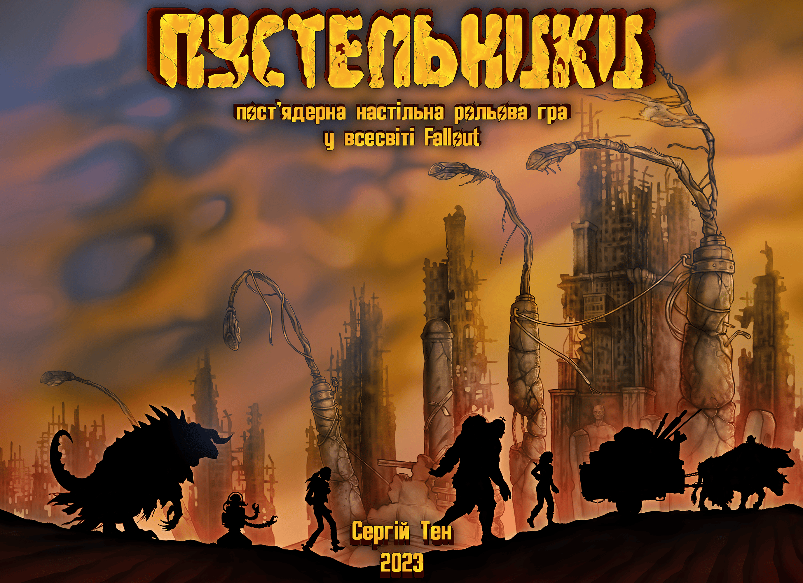
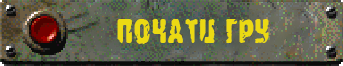
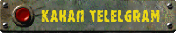
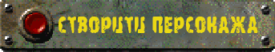
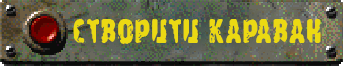
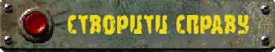
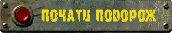
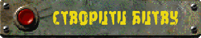
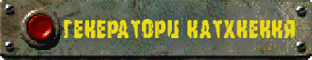

*Зроблено на основі гри [“Краєходці”](https://darkmentat.itch.io/krayehodci) (Кріс Вульф, Олівія Ґулін).*

Легка постапокаліптична настільна рольова гра про ватагу відчайдухів, авантюристів, торгашів, задирак і найманців, які разом зі своїм караваном йдуть до успіху крізь ядерну Пустку Західного узбережжя США. 

Мета гри — достовірно передати досвід класичних ігор серії Fallout, а також Fallout: New Vegas у зручному настільному форматі.

> [!NOTE]
> <!-- notion-emoji: aa923c95-9390-4597-a82b-1e16904aa61c/21ee66cd-8c78-8035-a7c1-007a3779f966 40px -->
>
> ## **ПРАВИЛА ГРАВЦІВ**
>

[Вступ](../contents.yml#vstup)

[Перевірки та дії](../contents.yml#perevirky-ta-dii)

[Створення персонажа](../contents.yml#stvorennia-personazha)

[Аспекти](../contents.yml#aspekty)

[Припаси, кришки, два стволи](../contents.yml#prypasy-kryshky-dva-stvoly)

[Караван](../contents.yml#karavan)

[Шкода та лікування](../contents.yml#shkoda-ta-likuvannia)

[Розвиток персонажів](../contents.yml#rozvytok-personazhiv)

[Доповнення: Guns. Lots of guns](../contents.yml#dopovnennia-guns-lots-of-guns)

> [!NOTE]
> <!-- notion-emoji: aa923c95-9390-4597-a82b-1e16904aa61c/21ee66cd-8c78-8052-995f-007aa540dc6a 40px -->
>
> ## **ПРАВИЛА ДОГЛЯДАЧА (ВЕДУЧОГО)**
>

[База](../contents.yml#baza)

[Основа гри: справи](../contents.yml#osnova-hry-spravy)

[Битви](../contents.yml#bytvy)

[Подорожі та небезпеки](../contents.yml#podorozhi-ta-nebezpeky)

[Довга гра: створення кампанії](../contents.yml#dovha-hra-stvorennia-kampanii)

[Фракції та поселення](../contents.yml#fraktsii-ta-poselennia)

[Супротивники та НІПи](../contents.yml#suprotyvnyky-ta-nipy)

[Для натхнення](../contents.yml#dlia-natkhnennia)

[Додаткові матеріали](../contents.yml#dodatkovi-materialy)

> [!NOTE]
> <!-- notion-emoji: aa923c95-9390-4597-a82b-1e16904aa61c/21ee66cd-8c78-80b8-9cac-007aa7069b47 40px -->
>
> ## НАД ГРОЮ ПРАЦЮВАЛИ
>

**Автор текстів, головний дизайнер:** [Сергій Тен](https://t.me/Merchantsten)

**Додаткові матеріали:** Сергій Тимошкін

[**Модуль Foundry VTT](https://foundryvtt.com/packages/wastelanders):** [Владислав Дракула](https://github.com/GMonlineua)

**Створення вікі:** Сергій Тен

**Обкладинка:** [Катерина Сечко](https://www.instagram.com/kerritarin_ks/)

**Дизайн аркушів персонажів та каравану:** [Іллаір](https://t.me/dfcamp)

**Плейтестери:** Олександр “Емперілас” Франковський, Артур Сарваров, Микита Шульга, Орина Комарницька, Сергій Дода, Святослав Демченко, Ілля Седякін, Станіслав Воробйов, Дар’я П’яних, Іван Стародубцев, Єлизавета Дубровська, Олена Вайнштейн, Юлія Яцкевич, Сергій Тимошкін, Ярослав Сулима, Олексій Трофімов, Борис Лисицький

**Переклад:** Максим Гапоненко

**Редактура:** Сергій Тен, Максим Гапоненко, Олександр Тріфан

### **Цієї гри не було б без:**

- **Комп’ютерні ігри:** Fallout 1 (Black Isle, Interplay), Fallout 2 (Black Isle, Interplay), Fallout: New Vegas (Obsidian Entertainment, Bethesda Softworks).
- **Настільні рольові ігри: [“Краєходці”](https://darkmentat.itch.io/krayehodci)** (Кріс Вульф, Олівія Ґулін), Fallout PnP (Джейсон Мікал), Fate Core (Evil Hat), World of Dungeons (Джон Гарпер), Apocalypse World (Вінсент Бейкер, Меґґі Бейкер).

**Окрема подяка** Олександру Тріфану та проєкту [«Кавалерія»](https://docs.google.com/document/d/1muJ6oUX9D6l9wXYR_V6oiT2YRO1K1bBzjpvAPJd6BmE/edit?tab=t.gl7put48p3sk) за натхнення допрацювати гру до кінця.

## Офіційний текст

*This work is partly based on Fate Core System and Fate Accelerated Edition (found at [http://www.faterpg.com/](http://faterpg.com/)), products of Evil Hat Productions, LLC, developed, authored, and edited by Leonard Balsera, Brian Engard, Jeremy Keller, Ryan Macklin, Mike Olson, Clark Valentine, Amanda Valentine, Fred Hicks, and Rob Donoghue, and licensed for our use under the Creative Commons Attribution 3.0 Unported license ([http://creativecommons.org/licenses/by/3.0/](https://creativecommons.org/licenses/by/3.0/)).*

*Права на всесвіт і торговельну марку Fallout належать ©Bethesda Softworks. Усі права захищені. Проєкт жодним чином не пов’язаний із і не підтримується Bethesda Softworks®.*

*Це некомерційний проєкт, створений фанатом для фанатів. Bethesda і Microsoft, будь ласка, не треба зі мною судитися.*

> [!NOTE]
> ©️
>
> *Правила гри розповсюджуються за ліцензією*
>
> [Creative Commons — Attribution-NonCommercial-ShareAlike 4.0 International — CC BY-NC-SA 4.0](https://creativecommons.org/licenses/by-nc-sa/4.0/)
>
> 
>

> [!NOTE]
> 🇺🇦
>
> Ця гра була випущена в Україні під час війни за Незалежність, що почалася 2014 року. **Слава Україні!**
>
> ### **Допомогти ЗСУ: [https://savelife.in.ua/donate/](https://savelife.in.ua/donate/)**
>

## Історія змін

- **Версія 2.0**
    - Глобально оновлено до версії 2.x [офіційний системний модуль для FoundryVTT](https://foundryvtt.com/packages/wastelanders).
    - Створено [трекер битв](https://serhiiten.github.io/wastelanders/all_generators.html#tracker).
    - Створено [електронний термінал Доглядача](https://serhiiten.github.io/wastelanders/all_generators.html).
    - Створено автоматичний [електронний аркуш персонажа](https://serhiiten.github.io/wastelanders/character_generator.html).
    - Створено автоматичний [електронний аркуш каравану](https://serhiiten.github.io/wastelanders/caravan_generator.html).
    - Проведено фінальний раунд редактури усіх текстів.
- **Версія 1.2**
    - Додано перки Якраз було! та Ментальний щит.
    - Додано [офіційний системний модуль для FoundryVTT](https://foundryvtt.com/packages/wastelanders) (велика подяка розробнику [Владиславу Дракулі](https://github.com/GMonlineua)).
    - Оновлено дизайн [листа персонажа](https://drive.google.com/file/d/1kvHwIjNGd581lAv3USvziFCi7uTe_OPO/view?usp=drive_link) та [листа каравану](https://drive.google.com/file/d/1B41WiF0cnhuLhkIUwdg9JTp83jPThXf4/view?usp=drive_link) (велика подяка Іллаіру та [Dense Forest Camp](https://t.me/dfcamp)).
    - Створено головне меню.
    - Проведено загальний раунд покращень для пришвидшення старту та максимальної автоматизації різних аспектів гри.
    - Додано [автоматичний генератор Пустельників](elektronnyi-arkush-personazha.md) для швидкого створення персонажів випадковим чином. Також є версія для [генерації вручну](henerator-pustelnykiv-ruchnyi.md).
    - Додано [автоматичний генератор каравану.](elektronnyi-arkush-karavanu.md)
    - Додано [автоматичний генератор справ](avtomatychnyi-henerator-sprav.md) для Доглядача.
    - Додано [автоматичний генератор подорожей](avtomatychnyi-henerator-podorozhei.md) для Доглядача.
    - Додано [автоматичний генератор битв](avtomatychnyi-henerator-bytv.md) для Доглядача.
    - Таблиці натхнення інтегровані в [автоматичний генератор](heneratory-natkhnennia.md).
    - [Всі генератори](https://app.notion.com/p/258e66cd8c7880ecb7fedd8f8bf65174?pvs=21) також доступні на одній сторінці.
    - Додано 10 нових [замовників справ.](struktura-sesii-stvorennia-sprav.md)
    - Додано опціональні правила для рідкісного випадку — [масових сутичок](ridkisni-vypadky.md).
    - Додано правила щодо [енергетичної зброї](zbroia.md).
    - Підкориговано таблиці [стрілецької зброї з доповнення](striletska-zbroia.md), підкориговано [таблиці винагород](nahorody-ta-zarobitok.md).
    - Додано особливість: [Професійний торчок](osoblyvosti.md) (автор ідеї: Олександр Франковський)
    - Додано видові особливості: [Виходець зі Сховища](vydovi-osoblyvosti.md) (для людей), [Здичавіння](vydovi-osoblyvosti.md) (для гулів), [Кіборг](vydovi-osoblyvosti.md) (для роботів), [Синт](vydovi-osoblyvosti.md) (для роботів).
    - Додано перки: Автоматний псих, По ногах, Нагляд, Фух, Все на переробку, Руйнівник, Погонич, Аналітична чуйка (автор ідеї: Олександр Франковський), В кожному порту, Талановитий митець, Експерт-робототехнік, Ремонтні протоколи, Мастак-ремонтник, Робо-друг, Савант.
    - Перк Шибайголова уточнено та посилено.
    - Додано нову фракцію супротивників — [Ши.](suprotyvnyky-shy.md)
    - Додано нових супротивників-роботів: [бум-око](suprotyvnyky-roboty.md), [робо-скорпіон Mk1](suprotyvnyky-roboty.md), [робо-скорпіон Mk6](suprotyvnyky-roboty.md), [важка турель](suprotyvnyky-roboty.md), [гігантський робо-скорпіон Х-42](suprotyvnyky-roboty.md) (фінальний бос).
    - Додано нових супротивників-мутантів: [тунельник](suprotyvnyky-mutanty-ta-inshi-koshmary.md) та [спороносець](suprotyvnyky-mutanty-ta-inshi-koshmary.md).
    - Додано нового фінального боса Братства Сталі — [бронетранспортер](suprotyvnyky-voiny-bratstva-stali.md).
    - Додано нового проміжного боса Легіону — [преторіанець](suprotyvnyky-biitsi-lehionu-tsezaria.md).
    - Додано нових рядових супротивників Анклаву: [лоботоміт](suprotyvnyky-zbroini-syly-anklavu.md) та [польовий дослідник](suprotyvnyky-zbroini-syly-anklavu.md).
    - Додано нового елітного супротивника з категорії дикунів — [мольфар](suprotyvnyky-bandyty-dykuny-reidery.md).
    - Оновлено [фішки персонажів](https://drive.google.com/file/d/1rMFTkVQZsoTeqeSGK66ztvh3tM5jq1X9/view).
    - Уточнені правила атак по кількох супротивниках та невибірковою зброєю.
    - Випадкова подія “Оаза в Пустці” тепер дає 1d6 замість 1d10 Припасів або запасу ходу.
    - Роботи більше не відновлюють ОЗ за відпочинок.
    - Видова властивість роботів “Бляшанка” тепер дає 2 фізичної броні.
    - “Рядовий боєць Анклаву” перейменований у “солдата Анклаву”, щоб уникнути плутанини.
    - “Видові особливості” перейменовані у “видові властивості”, щоб уникнути плутанини.
- **Версія 1.1.1**
    - Додані заповнювані листи [персонажів](https://drive.google.com/file/d/1kvHwIjNGd581lAv3USvziFCi7uTe_OPO/view?usp=drive_link) та [каравану](https://drive.google.com/file/d/1B41WiF0cnhuLhkIUwdg9JTp83jPThXf4/view?usp=drive_link), незначні виправлення верстки та дизайну.
    - Доповнені правила щодо [аспектів Концепцій, Проблем та Цілей](aspekty-personazhiv-hravtsiv.md) персонажів. Уточнено, в яких випадках гравець може використовувати їх, щоб здобувати жетони Долі.
    - Доповнені правила отримання [очків досвіду](ochky-dosvidu-ta-pokrashchennia.md). Тепер гравці мають можливість отримати ОД в кінці сесії, якщо під час гри значним чином використовували Концепції, Проблеми та Цілі своїх персонажів. Щодо цього додано нову фазу та запитання для отримання ОД в кінці сесії.
    - Видова особливість роботів “Експериментальна модель” тепер знижує ОЗ персонажа на 5 (було 3).
    - Доповнені правила щодо [Небезпек](nebezpeky-pustky.md).
    - Перк “Борис-хрін-поцілиш” перейменовано на “Борис-Кулю-минає”.
    - Перк “Цілющий дотик” тепер можна застосовувати частіше для відновлення ОЗ (було раз за сесію, стало раз за сцену).
    - Перк “Обраний” уточнено, вимоги знижено.
- **Версія 1.1**
    - Правила гри перенесені на вікі в Notion.
    - Додані численні перехресні посилання в тексті правил.
    - Доповнені розділи “Створення персонажа” та “Створення каравану”.
    - Переписаний розділ “Робимо перевірки”, щоб зробити зрозумілішим застосування кістки навички та виклик аспектів.
    - Виклики аспектів тепер дають тільки Посилення на перевірку.
    - Додані правила щодо нав’язування гравцями аспектів НІПам.
    - Реструктуровані та дописані розділи “Аспекти” та “Жетони Долі”.
    - Реструктурований розділ “Караван”.
    - Дописаний розділ “Створення каравану”.
    - Доповнена видова особливість “Сяючий”.
    - Особливість “Проклятий” більше не обмежена у використанні, а її текст доповнений щоб поширюватись і на негативні ефекти ходів НІПів, а не тільки на шкоду.
    - Перки “Зброяр” та “Броняр” дещо покращені, але тепер вимагають значення атрибуту ІН 0 або вище.
    - Перк “Медик” тепер вимагає значення атрибуту ІН або ВП +1 або вище.
    - Центуріон Легіону Цезаря тепер має 3 броні.
    - Майже всі супротивники категорії “бос” стали дещо небезпечнішими.
    - Доданий новий супротивник - штурмовик армії НКР
    - Літун тепер завдає додаткової шкоди радіацією.
    - Виправлений текст перка “Залізні кулаки”.
    - Перк “Міцна черепушка” перейменований на “Міцна довбешка”.
    - Перк “Непробивний” перейменований на “Невколупний”.
    - Доповнений текст щодо переміщення персонажів гравців, якщо їм щось заважає.
    - Доповнені правила битв щодо переміщення НІПів.
    - Відкориговані деякі ціни та ефекти важкої зброї в доповненні.
    - Численні виправлення текстів.